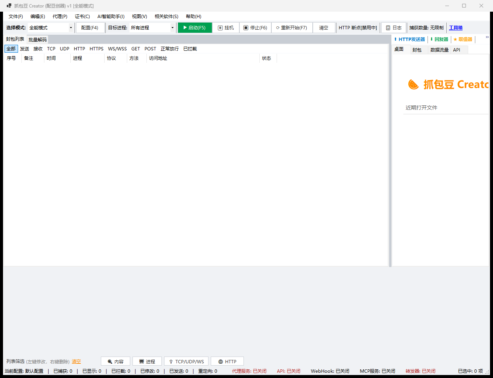

# 抓包豆 Creator (ZhuabaoCreater)

> 一个用 **.NET 8 WinForms** 从零实现的 Windows HTTP/HTTPS 抓包调试工具（MITM 代理 + 证书解密 + 改包 + 转发器 + 大模型辅助分析）。
> 界面布局参照 Fatbeans Creator，**全部源码为本仓库原创**，不包含原软件的任何代码或资源。

**当前版本：`v1`** · [下载最新版](https://github.com/zhengwuji/zhua-bao/releases/latest) · [更新日志](https://github.com/zhengwuji/zhua-bao/releases)



---

## 目录

- [它是什么](#它是什么)
- [下载与安装](#下载与安装)
- [快速上手（5 分钟）](#快速上手5-分钟)
- [功能详解](#功能详解)
  - [封包列表与详情](#封包列表与详情)
  - [HTTPS 解密](#https-解密)
  - [转发器（旁路转发到自己的 API）](#转发器旁路转发到自己的-api)
  - [自定义大模型接口](#自定义大模型接口)
  - [修改器：改状态码与次数限制](#修改器改状态码与次数限制)
  - [重发不会覆盖原封包](#重发不会覆盖原封包)
  - [手机 / Mac 抓包（局域网）](#手机--mac-抓包局域网)
- [命令行与自测](#命令行与自测)
- [从源码构建](#从源码构建)
- [版本号规则](#版本号规则)
- [自动构建与发布](#自动构建与发布)
- [常见问题](#常见问题)
- [免责声明](#免责声明)

---

## 它是什么

抓包豆 Creator 是一个**本地 HTTP/HTTPS 抓包调试工具**，用来观察、修改、重放本机程序与网站之间的网络请求。

典型用途：

- 调试自己开发的 Web / 桌面 / 移动端程序的接口
- 查看 App 与服务器之间到底发了什么、回了什么
- 修改请求/响应做联调（改状态码、改响应体、改请求头）
- 把抓到的流量**旁路**同步到自己的服务器做分析
- 让大模型帮忙解读某条会话是干什么的

**核心能力一览**

| 模块 | 说明 |
|---|---|
| MITM 代理 | 监听 `127.0.0.1:8899`，支持 HTTP 与 HTTPS（CONNECT 隧道 + 动态证书解密），连接级 keep-alive |
| 系统代理接管 | 启动自动把 WinINET 系统代理指向本机端口，停止/退出自动还原；异常退出有崩溃自愈标记 |
| 封包列表 | 虚拟列表 + 批量刷新，几万条会话不卡 UI；多协议过滤 Tab + 关键字/进程筛选 |
| 封包详情 | 预览 / 原始报文 / 请求 / 响应 / 修改 五个页签，请求头、请求体、响应体可直接编辑 |
| 转发器 | 条件匹配的 TCP 封包**旁路** POST 到自己的 API，不影响正常流量 |
| 自定义大模型 | OpenAI 兼容 / Anthropic 兼容两种模式，可直接分析选中封包 |
| 修改器 | 头/体/URL/状态码 增删改；支持 `:status` 改状态码与**次数限制** |
| 重定向 | 正则映射 URL，如 `api\.test\.com` → `api.prod.com` |
| 取值器 | 从响应表单/JSON/头/Cookie 按正则提取变量 |
| HTTP 发送器 | 编辑原始请求重发，支持 1/10/100/1000 次批量（**重发为副本，不动原封包**） |
| 工具箱 | Base64/Hex/URL 编解码、时间戳、MD5，以及专用解码器 GitHub 示例代码链接 |
| REST API / MCP | `127.0.0.1:8900`（REST）、`127.0.0.1:8901`（MCP JSON-RPC），供 AI 客户端调用 |
| WebHook | 每条完成会话 POST JSON 到配置地址（串行，会等响应） |

---

## 下载与安装

### 方式一：下载免安装版（推荐）

1. 打开 [Releases 页面](https://github.com/zhengwuji/zhua-bao/releases/latest)
2. 下载 `ZhuabaoCreater-v1-win-x64.zip`
3. 解压到任意目录（例如 `D:\Zhuabao`）
4. 双击 `ZhuabaoCreater.exe` 即可运行

**无需安装 .NET 运行时**（自包含单文件，约 64 MB）。

### 方式二：从源码构建

见 [从源码构建](#从源码构建)。

### 系统要求

- Windows 10 / 11 64 位
- 首次抓 HTTPS 需要安装一次根证书（程序会引导，见下）

---

## 快速上手（5 分钟）

### 第 1 步：启动代理

双击 `ZhuabaoCreater.exe`，点工具栏 **▶ 启动(F5)**。

启动后程序会自动把 Windows 系统代理指向 `127.0.0.1:8899`，所以 **Edge / Chrome 免配置直接就能抓**。

> 想让手机 / Mac 也抓？见 [手机 / Mac 抓包（局域网）](#手机--mac-抓包局域网)。

### 第 2 步：安装根证书（抓 HTTPS 必须）

点启动后会弹提示，选『是』→ Windows 再弹【安全警告】→ 点『是』即可。

也可以手动：菜单 **证书(C) → 查看/安装根证书状态**。

> 不装证书时 HTTPS 站点会报证书错误，**HTTP 站点不受影响**。
> Windows 的【安全警告】是系统对根证书写入的保护机制，点『是』属正常流程，不是病毒行为。

### 第 3 步：开始抓包

打开任意网页，左侧列表就会出现封包。点中任意一条，右侧「封包」页会显示它的全部内容。

### 第 4 步：停止

点 **■ 关闭(F5)** 或直接退出程序，**系统代理会自动恢复原设置**，不影响正常上网。

### 快捷键

| 键 | 功能 |
|---|---|
| `F5` | 启动 / 关闭代理 |
| `F6` | 停止代理 |
| `F7` | 清空列表并重新开始 |
| `F4` | 打开配置（改监听端口等） |

### 出问题怎么查

工具栏 **📋 日志** 或 菜单 **帮助(H) → 运行日志(实时调试)**：

- 实时显示每个环节：新连接 → 解析请求 → 改包/重定向 → 连上游 → 转发字节 → 收响应 → 回写客户端 → 存盘
- 可按级别过滤（DEBUG+/INFO+/WARN+/仅ERROR）
- 日志文件位置：`logs\zhuabao-年月日.log`（与本程序同目录）
- 卡住/无响应时，把日志最后 30 行发出来即可定位

---

## 功能详解

### 封包列表与详情

**列表**：序号 / 备注 / 时间 / 进程 / 协议 / 方法 / 访问地址 / 状态。

- 顶部 Tab 过滤：全部 / 发送 / 接收 / TCP / UDP / HTTP / HTTPS / WS / GET / POST / 正常放行 / 已拦截
- 底部筛选条：按「内容」关键字或「进程」名过滤
- 右键封包：重发 / 复制 URL / 复制请求头 / 保存为文件 / 删除

**详情**：点中列表任意一条，右侧「封包」页显示该会话全部内容，分 5 个页签：

| 页签 | 内容 |
|---|---|
| 预览 | 响应网页直接渲染（可切「源码」看 HTML） |
| 原始报文 | 请求 + 响应的完整原文 |
| 请求 | 请求头（可直接编辑） + 请求体 |
| 响应 | 响应头（可直接编辑） + 响应体 |
| 修改 | 大编辑框 + 多种修改方式 |

「修改」页签的多种修改方式：

1. 直接改文本
2. 查看方式切换：**文本 / JSON美化 / Base64 / Hex**
3. 「内容按 Base64 解码/编码」勾选框
4. **✔ 应用到会话** —— 把改动写回该会话
5. **⬆ 按此内容重发** —— 改完立即重发验证（生成副本，不动原封包）
6. **存为改包规则** —— 把「原内容 → 新内容」保存成全局规则，之后匹配的流量自动替换
7. **存为重定向** —— 把该 URL 存成重定向规则

### HTTPS 解密

程序首次启动会自动生成一张根证书（`Config\certs\rootCA.pfx`），用它给每个 HTTPS 站点动态签发叶子证书，从而实现解密。

**三个关键修复**（曾导致抓 HTTPS 全站失败，已全部修复并端到端验证）：

1. **叶子证书临时密钥**：`CopyWithPrivateKey` 产生的证书私钥是内存临时密钥，Windows SslStream 服务端握手报
   `platform does not support ephemeral keys`。改为导出 PFX 后以 `UserKeySet | PersistKeySet` 重新加载。
2. **CA 私钥明文导出**：`MakeLeaf` 里把 CA 私钥导成 PKCS8 PEM 再导入（且是死代码），CA 从 PFX 加载后私钥持久化在
   CNG 仓库，明文导出报「不支持请求的操作」。改为直接用 CA 证书签名。
3. **上游 SslStream 回调冲突**：回调同时放进构造器和 `SslClientAuthenticationOptions`，触发
   `The 'RemoteCertificateValidationCallback' option was already set in the SslStream constructor`。只保留 options。

> 用 curl 验证时注意：curl 使用 schannel 默认强制吊销检查，对本地自签 CA 需加 `--ssl-no-revoke`；用 `curl -k` 亦可跳过校验验证解密链路。
> 浏览器/.NET 程序在证书装好后无此限制。

**证书导出**（菜单 证书(C)）：

- 导出根证书 `.cer`（Windows 双击安装）
- 导出通用根证书 `.crt`（Mac / Android / iOS）
- 导出 iOS 描述文件 `.mobileconfig`（iPhone/iPad 最省事，装完还需去 设置 → 通用 → 关于本机 → 证书信任设置 打开完全信任）

> 导出的只含**公钥**，私钥始终留在 `Config\certs\rootCA.pfx`，不要外发 pfx。

### 转发器（旁路转发到自己的 API）

**菜单 代理(P) → 转发器(旁路转发 TCP/UDP)...**

把命中规则的封包，用 HTTP POST（JSON）**复制一份**发到你自己填的地址。

**关键语义：旁路（fire-and-forget）**

- 命中即丢入后台队列异步发送，**不等待响应、不阻塞、不影响**原有通讯
- 也不影响拦截器 / 修改器 / WebHook 的正常工作
- **只读不写**：不修改、不拦截封包，纯粹把数据复制一份发出去

> 和 WebHook 的区别：WebHook 是**串行**的（会等你的接口返回，超时会卡抓包）；转发器是**旁路**的。

**三步用起来**

1. **全局配置**：填「转发目标地址」（例 `http://127.0.0.1:9000/hook`），设并发 Worker（1~10）、队列上限、超时、单包上限 → 保存配置
2. **规则表**：加规则，填匹配条件与排除条件
3. 勾「**启用转发器**」→ 保存配置（代理在跑时立即生效）

**规则填写说明**

- 匹配条件要**同时满足**所填的每一项；整行匹配条件全空 = 转发全部 TCP/UDP
- 排除条件：命中任一项即不转发（**优先级高于匹配条件**）
- IP 支持 `192.168.*` 前缀写法，也支持逗号分隔多值：`10.0.0.1, 104.160.*`
- 端口/长度支持 `起-止`（如 `5000-5100`），只填一个数字 = 精确匹配
- 内容列前面加 `HEX:` 可按十六进制字节匹配，例：`HEX:68 65 6C 6C 6F`
- 队列满时会**丢弃最旧的封包**（底部统计能看到丢弃数），请合理设置队列上限
- 「发送测试封包」可以投一条测试包验证目标地址通不通

**转发数据格式**

命中规则的封包会被封装为 JSON，以 `Content-Type: application/json` POST 到你配置的地址。**接收端无需返回任何内容**，转发器不读取响应。

```json
{
  "Protocol": "TCP",
  "SrcIP": "127.0.0.1",
  "SrcPort": 0,
  "DstIP": "api.example.com",
  "DstPort": 443,
  "PID": 0,
  "ProcessName": "chrome",
  "DataLength": 512,
  "DataBase64": "UE9TVCAvYXBpL2xvZ2luIEhUVFAvMS4x...",
  "HexData": "50 4F 53 54 20 2F 61 70 69 2F 6C 6F 67 69 6E ...",
  "Timestamp": 1759536000000,
  "RuleID": "xxxxxxxx-xxxx-xxxx-xxxx-xxxxxxxxxxxx",
  "RuleName": "登录包",
  "Direction": "Send"
}
```

| 字段 | 说明 |
|---|---|
| `Protocol` | `TCP` 或 `UDP` |
| `SrcIP` / `SrcPort` | 源 IP / 源端口 |
| `DstIP` / `DstPort` | 目标 IP / 目标端口 |
| `PID` / `ProcessName` | 进程 ID / 进程名 |
| `DataLength` | 封包数据长度 |
| `DataBase64` | 完整封包 Base64 编码 |
| `HexData` | 完整封包 HEX 字符串（空格分隔） |
| `Timestamp` | 13 位毫秒时间戳 |
| `RuleID` / `RuleName` | 命中的规则 ID / 名称 |
| `Direction` | `Send` / `Receive`（本实现额外附带，接收端可忽略） |

**Python 接收端示例**

```python
from http.server import BaseHTTPRequestHandler, HTTPServer
import base64, json

class Hook(BaseHTTPRequestHandler):
    def do_POST(self):
        n = int(self.headers.get('Content-Length', 0))
        pkt = json.loads(self.rfile.read(n))
        raw = base64.b64decode(pkt['DataBase64'])
        print(f"[{pkt['Protocol']}] {pkt['SrcIP']}:{pkt['SrcPort']} -> "
              f"{pkt['DstIP']}:{pkt['DstPort']}  规则={pkt['RuleName']}  {pkt['DataLength']}B")
        print("   HEX:", pkt['HexData'][:120])
        print("   文本预览:", raw[:120])
        self.send_response(200); self.end_headers()

HTTPServer(('127.0.0.1', 9000), Hook).serve_forever()
```

> **说明**：本实现的抓包引擎是 HTTP/HTTPS 代理（未接网卡驱动），所以转发的是代理看到的 HTTP/HTTPS/WS 字节按方向切成的封包（请求=Send、响应=Receive），不是网卡级原始 TCP/UDP 报文。

### 自定义大模型接口

**菜单 AI智能助手(I) → 自定义大模型接口...**

支持两种协议方言，请求与响应结构差异全部由程序消化：

| 模式 | 端点 | 鉴权 |
|---|---|---|
| **OpenAI 兼容** | `POST {BaseUrl}/v1/chat/completions` | `Authorization: Bearer <key>` |
| **Anthropic 兼容** | `POST {BaseUrl}/v1/messages` | `x-api-key` + `anthropic-version: 2023-06-01` |

- BaseUrl 留空会用官方默认（`api.openai.com` / `api.anthropic.com`）
- 模型名示例：`claude-3-5-sonnet-latest`（Anthropic） / `gpt-4o-mini`（OpenAI）
- 「**请求预览**」把即将发出的 JSON 和鉴权头直接显示出来，方便离线核对
- 「**测试连接**」会真的发一次极小请求，验证 key / 网络 / 模型名是否可用

**Anthropic 兼容模式的实现要点**（与 OpenAI 的差异）：

- `system` 提示词**提到顶层独立字段**，不放在 `messages` 里（Anthropic 不接受 `system` 角色）
- `messages` 只允许 `user` / `assistant`，且必须**交替**；连续的相同角色会被自动合并
- `max_tokens` 是**必填**字段
- 响应取 `content[]` 里 `type == "text"` 的片段拼接，另读 `stop_reason` 与 `usage`

**用大模型分析封包**

选中一条封包后 → 菜单 **AI智能助手(I) → 用大模型分析当前封包**，程序会把请求与响应各截 6000 字符发给模型，弹出的结果窗口可复制或查看原始 JSON。

### 修改器：改状态码与次数限制

**改状态码**：修改器里把「目标」选 `:status`（伪头名），「值」填目标状态码：

| 值写法 | 效果 |
|---|---|
| `404` | 只改码，原因短语自动用标准短语（Not Found） |
| `403 Forbidden` | 码 + 自定义原因短语 |
| `200-299` | 在这个区间里随机取一个码 |

> 也可以直接用「状态行」目标，效果相同。非 `:status` 的响应头规则行为不变，老规则文件无需修改。

**次数限制**：规则表有「限次」「次数」「已用」三列。

- 勾上「限次」并把「次数」设为 N，这条规则最多生效 N 次，之后自动跳过
- 已用次数由程序**按规则内容记住**：保存配置、关掉重开面板都**不会清零**
- 改了规则的任何内容（方向/目标/匹配/类型/值/备注）＝一条新规则，次数从 0 重新算
- 想手动清零：「重置选中规则次数」或「全部重置次数」
- 重启程序后计数从 0 开始

### 重发不会覆盖原封包

右键 **重发此请求** 或 详情页 **按此内容重发**，都会生成一条**新的副本会话**：

- 副本的备注写成「重发副本 ← 原会话ID」，在列表里一眼能认出来
- **原封包的内容与原始字节完全不变**，随时可以对照、可以再次重发
- 批量重发（10/100/1000 次）时，界面上最多只显示前 20 条副本，其余仍会落盘

### 手机 / Mac 抓包（局域网）

默认只听 `127.0.0.1`，只有本机能用。要让手机/Mac 抓，走这三步：

**第 1 步：开启局域网模式**

菜单 **代理(P) → 手机 / Mac 抓包向导（局域网）...**

- 勾选「允许局域网设备连接」→ 代理改为监听 `0.0.0.0`（任何网卡都能连）
- 点「放行防火墙」（会弹 UAC，放行入站 TCP 8899；仅专用/域网络）

**第 2 步：拿到本机局域网地址**

看向导里的「本机局域网地址」，例如 `192.168.1.100:8899`。对端设备与本机必须在同一个局域网，且能 ping 通。

**第 3 步：对端装根证书 + 设代理**

装根证书（不装则 HTTPS 报证书错误）：

- 菜单 **证书(C) → 导出通用根证书 .crt** → 拷到对端安装
- iPhone/iPad 更省事：**导出 iOS 描述文件 .mobileconfig**，传到手机点安装 → 设置 → 通用 → VPN与设备管理 → 安装 → **必须再去 设置 → 通用 → 关于本机 → 证书信任设置 → 打开「完全信任」**
- macOS：双击 `.crt` → 钥匙串访问 → 系统 → 设为「始终信任」（Firefox 有独立信任库，需另外导入一次）
- Android：设置 → 安全 → 加密与凭据 → 安装证书 → CA 证书

对端设置代理（手动，填本机局域网地址）：

- Windows：设置 → 网络和Internet → 代理 → 手动设置 → 地址+端口
- macOS：系统设置 → 网络 → 详细信息 → 代理 → 网页/安全网页代理
- iOS：设置 → 无线局域网 → 点当前 Wi-Fi 的 ⓘ → 配置代理 → 手动
- Android：WLAN → 长按网络 → 修改 → 高级 → 代理 → 手动

> 向导里「**复制步骤**」可把上面全部内容拷成文本，方便照做。

**注意事项**

- 局域网模式**没有账号密码**：同网段任何设备都能用本代理，抓完请取消勾选切回「仅本机」，或直接关掉代理
- Android 7 以上，App 默认不信任用户安装的证书（只有走系统信任库的浏览器类才生效）；自带信任策略或做了证书固定（App 内置 CA）的 App 抓不到，需要在 App 层放行，属于系统机制不是本程序的问题
- **QUIC / HTTP/3 流量不走 HTTP 代理**，抓不到属正常现象（可在浏览器关闭 QUIC）

---

## 命令行与自测

程序内置四套自测，都可在无人值守下跑：

```text
ZhuabaoCreater.exe --selftest     # 核心逻辑自测（52 项）：证书/SAN/导出/解析/规则/存储/脚本/局域网辅助/分帧/解压/Set-Cookie
                                  #   + 转发器条件匹配与队列、转发 JSON 字段、大模型两种方言与响应解析、
                                  #     次数限制计数表、:status 改状态码、重发副本不改原封包、旧配置兼容、解码器链接表、
                                  #     MCP/REST 服务端到端（真的起 HttpListener 用 JSON-RPC 调通）
ZhuabaoCreater.exe --enginetest   # 引擎端到端自测：HTTP转发/大POST补全/gzip解压/chunked/close定界/keep-alive/WS透传
                                  #   /局域网HTTPS解密+隧道复用 + 转发器接线（真发一次请求，断言旁路到达且原流量不受影响）
ZhuabaoCreater.exe --proxytest    # 系统代理接管 / 还原闭环自测
ZhuabaoCreater.exe --uitest       # 自动化 UI 测试：无人值守把每个功能点一遍（详见下节）
ZhuabaoCreater.exe --autostart    # 启动后自动开启代理（并启用日志文件）
```

**退出码 0 = 全部通过。**

### 自动化 UI 测试（--uitest）

把界面上每一个功能点自动点一遍，不需要人工参与：

```powershell
ZhuabaoCreater.exe --uitest        # 退出码 = 失败项数，0 表示全部通过
```

覆盖：全部菜单项、工具栏与过滤条按钮、左右两侧页签、封包列表右键菜单、
封包详情（预览/原始报文/请求/响应/修改）的每个页签与按钮、以及每个对话框
（配置 / HTTP发送器 / 回复器 / 取值器 / 重定向 / 封包对比 / 工具箱 / 修改器 /
转发器 / 自定义大模型接口 / 日志查看器 / 局域网向导）内部的控件。

实现要点：

- 弹出来的模态对话框由后台守卫线程自动关闭（等同点「取消」）
- 会弹 UAC 或 Windows【安全警告】保护框的项自动跳过并记录原因
- 额外跳过三类「会真的对外发起动作」的按钮并记录原因：转发器面板的「发送测试封包」、大模型面板的「测试连接」、工具箱的「打开示例代码」/GitHub 外链
- 运行结束自动还原系统代理注册表快照、清理测试期间装上的临时根证书，并扫描日志里的 ERROR

报告写到 `uitest-report.txt`（与 exe 同目录），一轮约 30 秒。

---

## 从源码构建

### 环境要求

- [.NET 8 SDK](https://dotnet.microsoft.com/download/dotnet/8.0)
- Windows 10 / 11

### 编译

```powershell
git clone https://github.com/zhengwuji/zhua-bao.git
cd zhua-bao
dotnet build Zhuabao\Zhuabao.csproj -c Release
```

产物：`Zhuabao\bin\Release\net8.0-windows\ZhuabaoCreater.exe`（双击运行，需 .NET 8 Desktop Runtime）。

### 发布单文件免安装版

```powershell
dotnet publish Zhuabao\Zhuabao.csproj -c Release -r win-x64
# 产物：Zhuabao\bin\Release\net8.0-windows\win-x64\publish\ZhuabaoCreater.exe
```

csproj 已内置单文件 / 自包含 / 压缩配置，产物约 64 MB，目标机器无需安装运行时。

### 项目结构

```text
Zhuabao.Core/          核心库
  AppInfo.cs           版本号唯一来源（递增式 v1/v2/v3…）+ 窗口标题/关于文本
  ProxyEngine.cs       MITM 代理引擎（HTTP/HTTPS/WS 全流程）
  StreamIO.cs          HTTP 分帧读取（Content-Length / chunked / close-delimited）
  HttpMessage.cs       请求/响应容器与序列化
  Forwarder.cs         转发器：条件匹配 + 有界队列 + 后台并发 POST（旁路）
  LlmService.cs        自定义大模型接口：OpenAI 兼容 / Anthropic 兼容
  Engines.cs           重定向 / 改包（含 :status 改状态码与 RuleHitRegistry 次数计数）/ 取值
  CertCache.cs         CA 与叶子证书动态签发（LRU 缓存）
  CertTrust.cs         根证书安装/信任检查
  CertExport.cs        导出 .cer / .crt / .mobileconfig
  Session.cs           会话模型与异步落盘仓库
  Config.cs            配置模型与读写
  SystemProxy.cs       系统代理接管与崩溃自愈
  LanHelper.cs         局域网抓包辅助（地址枚举/防火墙/步骤文本）
  ProcessLocator.cs    通过 iphlpapi 把连接归属到进程
  JsScriptEngine.cs    JS 改包脚本引擎（Jint）
  ApiService.cs        REST API + MCP JSON-RPC 服务
Zhuabao/               WinForms 主程序
  MainForm.cs          主窗口（菜单/工具栏/列表/状态栏）
  SessionDetailPanel.cs 封包详情与改包面板
  Dialogs.cs           各类对话框（发送器/转发器/大模型/修改器/工具箱/…）
  EngineTest.cs        --enginetest 引擎端到端自测
  UiTest.cs            --uitest 自动化 UI 测试
  Program.cs           入口 + --selftest 核心自测
smoke.ps1              GUI 端到端冒烟测试脚本
```

---

## 版本号规则

自 `v1` 起，对外版本号使用**递增式简写 `v1` / `v2` / `v3` …**。
每次发版**只需改一个常量**：

```csharp
// Zhuabao.Core\AppInfo.cs
public const string Version = "v1";   // 下次发版改成 "v2"，再下次 "v3" …
```

标题栏、关于窗口、启动日志、REST API 与 MCP 的 `version` 字段全部从 `AppInfo.Version` 取值，改一处即全局生效：

| 位置 | 取值来源 | 当前显示 |
|---|---|---|
| 窗口标题 | `AppInfo.WindowTitle` | `抓包豆 Creator (配豆创器) v1 [全能模式]` |
| 关于窗口 | `AppInfo.AboutText` | 含本次更新项清单 |
| 启动日志 | `AppInfo.Version` + `AppInfo.AssemblyVersionText` | `抓包豆 Creator v1 pid=…` / `程序集版本: v1 (1.0.0)` |
| REST API | `AppInfo.Version` | `{"service":"zhuabao-api","version":"v1"}` |
| MCP | `AppInfo.Version` | `serverInfo.version = "v1"` |

**发版清单（三步）**

1. 改 `Zhuabao.Core\AppInfo.cs` 的 `Version`（`v1` → `v2`）
2. 同步改两个 csproj 的 `<Version>`（`1.0` → `2.0`，用于程序集版本与文件属性）
3. 提交并推送 —— **CI 会自动编译并把 exe 挂到 Release 上**（见下节）

---

## 自动构建与发布

本仓库配置了 GitHub Actions：**每次向 `master` 推送代码改动，都会自动编译出 exe 并发布到 Releases**。

工作流文件：[`.github/workflows/build-release.yml`](.github/workflows/build-release.yml)

### 触发条件

```yaml
on:
  push:
    branches: [master]
    paths-ignore:
      - 'README.md'        # 只改 README 不触发编译
  workflow_dispatch:        # 也可在 Actions 页手动触发
```

- **只改 `README.md` 不会触发编译**（按需求排除）
- 改任何源码、csproj、工作流本身都会触发

### 自动做的事

1. 检出代码，安装 .NET 8 SDK
2. `dotnet publish -c Release -r win-x64` 编译出自包含单文件 exe
3. 跑一遍 `--selftest` 做冒烟检查（失败则整个工作流失败，不会发出坏包）
4. 把 exe + 使用说明打包成 `ZhuabaoCreater-v1-win-x64.zip`
5. 创建/更新 Release，标签为 `v1`，正文是中文更新说明

### 关于版本号

工作流从 `Zhuabao.Core/AppInfo.cs` 里读出 `Version` 常量（`v1` / `v2` / …），
自动用作 **Release 标签**与**附件文件名**。所以发版时改完 `AppInfo.cs` 推上去即可，不需要手动打 tag。

### 手动触发

在 GitHub 仓库页 → **Actions** → 左侧选 **Build and Release** → **Run workflow**。

---

## 常见问题

**Q：启动后上不了网了？**

程序异常退出（崩溃/被强杀）时，系统代理可能还指着已死的端口。下次启动会自动检测并还原
（原设置记在 `sysproxy-crash.mark`）。如果仍然断网：

- 菜单 **代理(P) → 恢复系统代理原设置**
- 或 Windows 设置 → 网络和Internet → 代理 → 关闭「使用代理服务器」

**Q：HTTPS 站点报证书错误？**

根证书没装或没被信任。菜单 **证书(C) → 查看/安装根证书状态**。
装的时候 Windows 会弹【安全警告】，必须点『是』。

**Q：端口 8899 被占用？**

按 `F4` 打开配置换成其他端口（如 8888）。注意程序有单实例保护，重复双击会提示「已在运行」。

**Q：为什么有些 App 抓不到？**

- Android 7 以上 App 默认不信任用户证书，且做了证书固定的抓不到（系统机制）
- QUIC / HTTP/3 流量不走 HTTP 代理
- 程序换了目录或删了 `Config` 目录会重新生成一张 CA，需要**重新安装一次根证书**

**Q：转发器没收到数据？**

对照规则检查：目的端口是否写对（这是最常用的匹配项）、内容关键字是否命中。
可以用面板里的「发送测试封包」先验证目标地址通不通。

**Q：大模型调用失败？**

先点「测试连接」。常见原因：API Key 无效、模型名写错、BaseUrl 不对。
面板里的「请求预览」会显示实际发出的 JSON 和鉴权头，方便对照官方文档核对。

**Q：卸载怎么弄？**

直接删除整个文件夹即可；证书可用 菜单 **证书(C) → 卸载根证书** 移除。

---

## 免责声明

本工具仅供**学习研究与合法的授权测试**使用。

- 请仅对你**自己拥有或已获得明确授权**的系统、应用与网络进行抓包分析
- 抓包内容可能包含他人隐私数据，请遵守当地法律法规，不得用于非法用途
- 使用本工具产生的一切后果由使用者自行承担

本项目为**独立实现**，与 Fatbeans Creator 的开发者无关，不含其任何代码或资源。

## 开源许可

见 [LICENSE](LICENSE)（若未随仓库提供，默认保留所有权利，使用前请先联系作者）。
